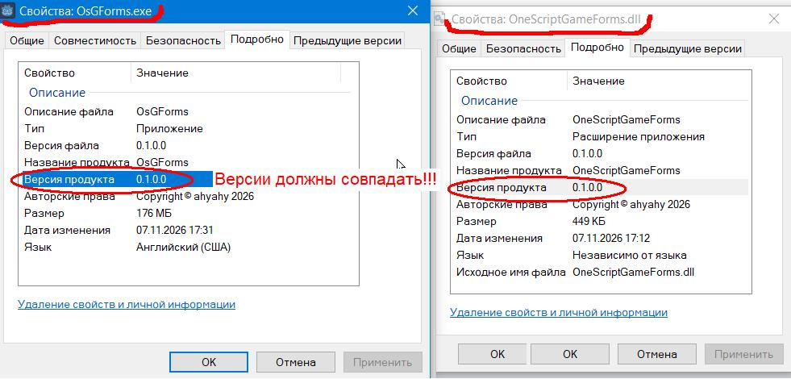

# OneScriptGameForms
Игровые формы Godot для сценарного языка OneScript

### Подробнее можно узнать на этом сайте

> <https://ahyahy.github.io/OneScriptGameForms/index.html>

### osgf — ИгровыеФормы: библиотека управления игровым движком Godot из OneScript

**osgf** (OneScript Game Forms) — библиотека, которая позволяет писать приложения на языке OneScript с полнофункциональным графическим интерфейсом [игрового движка Godot](https://godotengine.org). Сценарий на OneScript управляет окнами, элементами, темами и отрисовкой Godot, а вся логика обработки событий остаётся в привычном синтаксисе 1С.

## Некоторые возможности

- Создание и управление окнами, контейнерами и контролами Godot (кнопки, надписи, поля ввода, панели и др.) из кода OneScript.
- Работа с темами: цвета, шрифты, размер шрифта, иконки, стили оформления для разных типов элементов управления.
- 2D-отрисовка графических примитивов: окружности, эллипсы (в том числе дуги), прямоугольники, линии (в том числе штриховые), ломаные, многоугольники с текстурой, символы и др.
- Снимки окна в память и на диск в различных графических форматах (PNG / JPG / WEBP).
- Работа с буфером обмена (текст), и системными каталогами, получение и изменение пикселей.
- Событийная модель: нажатия кнопок, переключения флажков, изменения размеров, клавиатура и таймеры (в том числе одноразовые).
- Подгрузка моделей (GLB) в сцену.

## Архитектура: как библиотека связана с Godot

Библиотека не встраивается в Godot как модуль — она **запускает Godot отдельным процессом** и общается с ним через стандартные потоки stdin/stdout по строкам JSON.

Здесь позже будет какая то схема.

Ключевые решения:

- **GodotHost.cs** читает stdin в отдельном потоке, но исполняет команды строго в главном потоке Godot — через очередь команд. Это гарантирует потокобезопасность всех операций с узлами и контролов.
- **Каждая команда имеет `id`**; на стороне библиотеки для неё заводится словарь команд, поэтому сценарий может вызвать метод и получить результат синхронно.
- **Обмен объектами по ключам.** Все элементы (окна, кнопки, темы, текстуры...) имеют строковый `КлючЭлемента`. Соответствие «ключ → объект» хранится на обеих сторонах в словарях — по ключу сценарий и Godot находят «свой» объект друг у друга.
- **Кодировка UTF-8** задается явно для stdin/stdout с обеих сторон — русские тексты в заголовках, надписях и логах передаются корректно.

## Состав библиотеки

### Сторона OneScript (сборка osgf)

- **GameForms.cs** — этот модуль содержит главный класс. Запускает процесс Godot, ведёт реестр команд, очередь событий и словари ключей. Синглтон: все `Новый ИгровыеФормы()` возвращают один экземпляр.
- **Классы-обёртки контролов** — для элементов управления кнопка, окна, контейнеры, темы и т. д. У каждого класса два имени: русское и английское, оба можно использовать на равных правах.
- **OsUtils** — утилиты сериализации/десериализации, конвертация значений между типами OneScript и Godot, преобразование имён свойств (camelCase ↔ snake_case).

### Сторона Godot (проект Godot с C#)

- **GodotHost.cs** — узел-посредник: читает поток stdin, обрабатывает очередь команд, отправитель событий и ответов.
- **MyDrawer** — накопитель параметров отрисовки графических примитивов: параметры складываются в словарь `DrawParams.cs `, после метода `MarkDirty()` всё перерисовывается в обратном вызове `_Draw()` одним проходом.

## Как обрабатываются события

1. При создании `ИгровыеФормы` библиотека запускает **фоновое задание** с циклом событий:
   ```
   Пока ИФ.Продолжать Цикл
       ИФ.ПолучитьСобытие().Выполнить();
   КонецЦикла;
   ```
2. Godot отправляет события в JSON-строке (например, `KeyPress` с кодами клавиш, модификаторами и признаком нажатия/отпускания; клики, переключения, ресайз — от соответствующих контролов).
3. Библиотека кладёт событие в потокобезопасную очередь.
4. Фоновое задание достаёт событие и **выполняет назначенный сценарный обработчик**. Исключения в обработчиках перехватываются и пробрасываются с указанием модуля и строки, а критическая ошибка завершает приложение с кодом 1.

Такой дизайн снимает с автора сценария необходимость писать собственный главный цикл: достаточно объявить обработчики — остальное делает библиотека.

## Наследование и структура классов

Каждый публичный тип библиотеки построен по двухслойной схеме:

- **Внутренний слой** (классы `Button`, `Window`, `PanelContainer`...) — прямой носитель `ItemKey` и методов `Get/SetGodotProperty`, которые превращают обращение к свойству в JSON-команду к Godot. Классы наследуются друг от друга зеркально иерархии Godot (`Button : BaseButton : Control...`).
- **Слой для сценария** (классы `GfButton` и т. п., `AutoContext<>`) — регистрируется в OneScript атрибутами `[ContextClass]`, `[ContextProperty]`, `[ContextMethod]` и делегирует всё внутреннему слою через поле `Base_obj`. Свойство уровня Godot и свойство уровня сценария связаны парами: `Текст` ↔ `Text`, `Отображать` ↔ `Visible`.

Имена «русская ↔ английская» и «Godot-имя ↔ имя свойства» вычисляются автоматически (методы `GetGodotName` / `GetCSharpName`), поэтому добавление нового свойства сводится к добавлению пары свойств в оба слоя.

## Пример сценария

<!-- Проверьте имена методов и событий по вашей справке — здесь они даны ориентировочно. -->

```bsl
Перем ИФ;

Процедура Кнопка1_Нажатие() Экспорт
	Сообщить("Кнопка1_Нажатие " + ИФ.ТекущаяДатаСМиллисекундами());
КонецПроцедуры

ПодключитьВнешнююКомпоненту(ОбъединитьПути(ТекущийСценарий().Каталог, "OneScriptGameForms.dll"));
ИФ = Новый ИгровыеФормы();
ИФ.Запустить(ОбъединитьПути(ИФ.КаталогБиблиотеки, "OsGForms.exe"));

ИФ.КорневоеОкно.Заголовок = "Привет, Godot!";

Кнопка1 = ИФ.КорневоеОкно.ДобавитьДочерний(ИФ.Кнопка());
Кнопка1.Текст = "Нажми меня";
Кнопка1.Центр();
Кнопка1.Нажатие = ИФ.Действие(ЭтотОбъект, "Кнопка1_Нажатие");

// Добавим цикл, чтобы оставить сценарий запущенным.
// Это не касается Godot, у него свой цикл обработки событий, в фоновом задании.
Пока ИФ.Продолжать Цикл
	Приостановить(1000);
КонецЦикла;
```

## Тесты

В справке на каждое свойство, метод, событие будет пример, который является и тестовым: создание и свойства контролов, темы, отрисовку, снимки экрана, буфер обмена и т.д.

## Ограничения и планы

- Пока создан базовый функционал и основные обслуживающие классы.
- Из элементов управления создан класс `Кнопка` и `Надпись`.
- В планах: расширение набора контролов, поддержка видео и аудио.

## Требования

- OneScript (версия 2.х),
- Godot 4.6 с поддержкой C# (.NET). Готовая сборка шаблона экспортированная из редактора Godot находится в репозитории. Это exe файл и он включает в себя всё, что необходимо для работы приложения. Для разных платформ нужен свой экспортированный шаблон. Пока он подготовлен только для ОС Windows.
- Так как требуется согласованный выпуск сборки шаблона (OsGForms.exe) и библиотеки OneScriptGameForms.dll прошу обратить особое внимание на совпадение их версий. Откройте свойства обоих файлов, перейдите на вкладку `Подробно` и сверьте их значения `Версия продукта`.



- На сейчас указанные файлы вы найдете в [каталоге docs](https://github.com/ahyahy/OneScriptGameForms/tree/main/docs)
